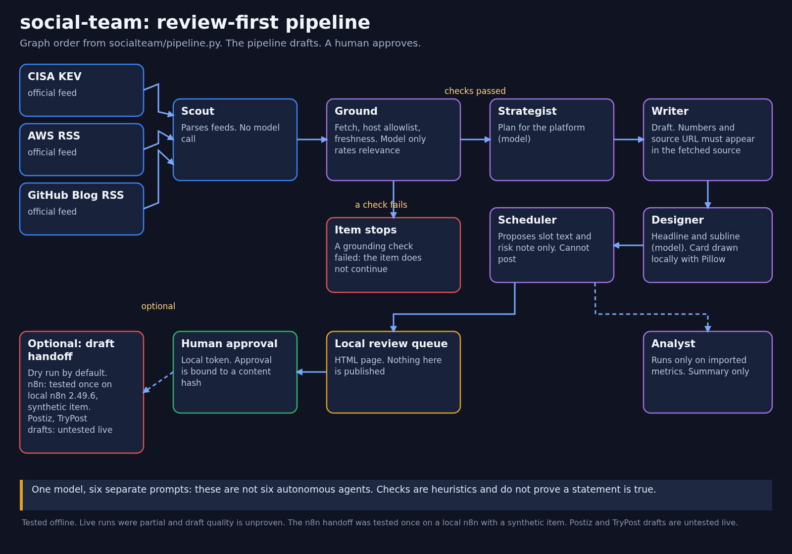
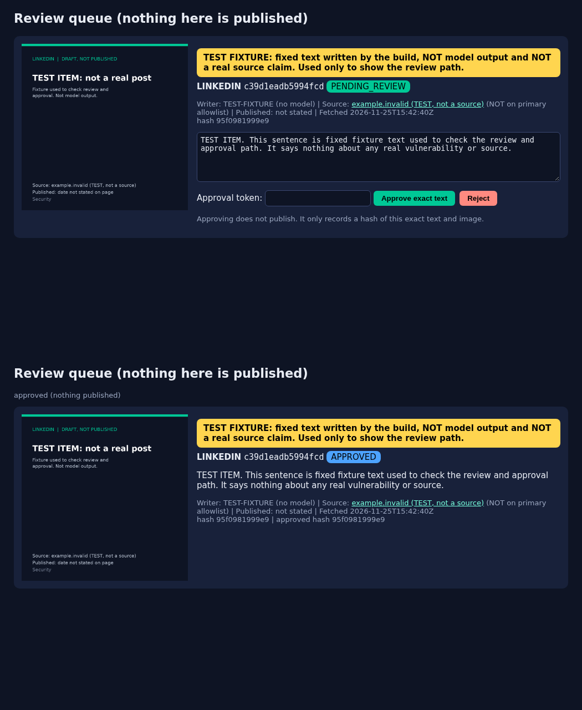

# social-team

A local, review-first content pipeline for security-focused social posts. It is a LangGraph graph with six role steps behind one model interface:
trend scout, strategist, writer, designer, scheduler, analyst.

**It never publishes.** It drafts, checks claims against fetched sources, renders an image card, and queues items in a local HTML review page.
A human approves each item with a local token. Approval is bound to a content hash.

## Status (read this first)
The checks below are heuristics: every number and the source URL in a draft must appear in the fetched source text, and a few claim patterns are blocked. They do not verify that a statement is true or complete. A human must review every item.

**Tested offline:** grounding, freshness and SSRF guards, budget ledger, approval gate, role schema checks, graph wiring with a mock model, strict mode and checkpoint resume (69 tests, no network).

**Run live (partial):** on public feeds with a free OpenRouter model, the trend-scout step produced ratings for 3 real CISA KEV items. A later live strategist step for one item failed: two earlier strategist responses were rejected by validation (the raw text was not kept then), and the latest attempt timed out after 90 seconds with no response. No strategist, writer, designer or scheduler output has been reviewed yet. Draft quality is unproven.

**Not built:** publishing to any platform. The only outbound handoff is a drafts-only adapter (see `publish-drafts` below), dry run by default. The n8n handoff was run once against a local n8n 2.49.6 with a synthetic approved item (see docs/N8N_HEADERAUTH_ACCEPTANCE.md); the Postiz and TryPost drafts adapters have never been run against a live instance. Drafts are for a human to post. The paid Grok provider path has not been run (it needs prepaid xAI credits). "Primary source" in this code means only "from an allowlisted official host". It does not mean the publisher's claims are verified.

## Review page (test fixture)
The local review page with a fixed TEST FIXTURE item, before and after approval. The text is written by the build, not by a model, and is not a real post. Approving records a hash and publishes nothing.

## What the model is asked to do (traced from `socialteam/pipeline.py`)
One model, six separate prompts. These are not six autonomous agents.
| Step | Model call? | Per item | Notes |
|---|---|---|---|
| scout | no | 0 | feed parsing (CISA KEV, AWS RSS, GitHub Blog RSS) |
| ground | trend_scout: yes | 1 | fetch, allowlist, freshness are deterministic; the model only rates relevance |
| strategist | yes | 1 | plan for the platform |
| writer | yes | 1 | draft text; claim check is deterministic |
| designer | yes | 1 | headline and subline for the card; card is drawn locally with Pillow, no image model |
| scheduler | yes | 1 | proposes a slot text and risk note only. It cannot schedule or post |
| analyst | yes, only if metrics were imported | 0 or 1 per run | summary of imported metrics |
Each role gets up to 3 attempts (1 call plus 2 retries) when its output fails the schema or semantic checks. One item needs at least 5 model calls and at most 15. A 3-item run needs 15 to 45 calls.
Role results are saved per item as checkpoints: a saved result is never requested again, and a run that stops partway resumes at the next stage. Failed attempts are logged locally (redacted, first 2000 chars) in the run's database. The `out*/` directories are git-ignored.

## Strict, stage-by-stage runs (for cautious live testing)
    ST_STRICT=1 ST_MAX_ITEMS=1 ST_RETRIES=0 ST_STOP_AFTER=strategist python -m socialteam run
`ST_FREE_MODELS=a:free,b:free` sets an ordered list of zero-price routes (live price re-checked per route). A route that stalls (`ST_FIRST_EVENT_S`, default 30s, no model output event), times out or returns 429/5xx falls through to the next one, at most one attempt per route per call, each counted in the request ledger. A validation rejection never falls through. Each draft records the route that actually answered, and every attempt is stored as a `route` event. Fallback sends the same public text to a different provider, so every route must be listed by the user in `ST_FREE_APPROVED_ROUTES` (the run refuses any other), each request is pinned to that route's single provider (`only` plus `allow_fallbacks:false`), and a fallback list must use distinct providers so a throttled provider is never retried under another model alias. `ST_FREE_ALLOW_RETENTION` only controls the data-collection filter; it is not route approval. OpenRouter's public endpoint metadata shows 100% uptime but no latency or throughput for these routes, so it is not a usable health signal; only a live first-event check is.

Live findings on the free routes (November 25, 2026, single item): the Nvidia route produced no output event in 100s on four calls. On Baidu ERNIE 5.5 Flash the strategist and writer answered in seconds; the Ant Ling 3.2 Flash route spent its whole 2500-token output budget on hidden reasoning with no answer text (so the budget is now 6000, unproven for Ling). Two checker defects were found by real output: a 160-character cap on internal strategist notes rejected a correct 171-character point, and the exploitation-claim check treated a "don't say it was exploited" prohibition as a claim. Both are fixed with tests. Designer and scheduler have not run live yet: both routes returned HTTP 429 (temporarily rate-limited upstream). A passing validator is not a review: the Medium draft produced is source-grounded but says a KEV listing does not mean exploitation, which a human must judge.

`ST_FREE_STREAM=1` uses the documented SSE streaming form of the Responses API, with a 30s idle timeout and a 100s total deadline, and records a timeline (first byte, event counts, keep-alive comments) so a stall shows where it stopped. Live observation on the tried free route: the connection opened after about 10s, then only keep-alive comments arrived for 90s and no model output event. Cause unresolved. The request cap (2500 output tokens, low reasoning effort) is a configuration change, not a proven fix.

Strict mode halts at the first rejection or error in any model stage (no fallback card, no review-queue entry, no later calls) and records why in the run database. `ST_STOP_AFTER` is one of ground, strategist, writer, designer, scheduler. Run the stages one at a time; each run resumes from the saved checkpoints. `ST_FREE_REQUESTS` caps total free-route requests recorded in the local ledger, and an unanswered request stays counted.

## Layout
- `socialteam/` code (feeds, grounding, net, roles, pipeline, review, design, budget, llm providers, analytics)
- `tests/` offline tests, no network (`python -m unittest discover -s tests`)
- `brand/brand.example.md` copy to `brand/brand.md` and edit; only the `Voice:` line is sent to free routes
- `docs/` acceptance notes

## Run
    python3 -m venv .venv && . .venv/bin/activate     # tested with Python 3.10
    pip install -r requirements.txt                   # direct dependencies pinned; transitive ones are not
    python -m unittest discover -s tests
    ST_OUT=out python -m socialteam run --mock          # mock model, wiring only
    ST_OUT=out python -m socialteam run                 # extractive, no model
    OPENROUTER_API_KEY=... ST_FREE_MODEL=<free model id> ST_FREE_REQUESTS=20 python -m socialteam run   # zero-price models only
    XAI_API_KEY=... ST_DAILY_CAP_USD=0.25 python -m socialteam run                                       # Grok, paid
    python -m socialteam init-token; python -m socialteam approve <id>

Free route sends `data_collection: deny` by default. `ST_FREE_ALLOW_RETENTION=1` allows endpoints that may train on inputs. Send only public text.
API keys are read from environment variables only and are never written by this code. Drafts, run events, fetched public source text, failed model responses and the review page are stored locally under `ST_OUT` (git-ignored). Secret redaction of failed responses is best effort (key-shaped strings and emails only). Treat `out*/` as private. Set `ST_BYLINE` for the card footer.

## Data sources and third-party notes
Feeds: CISA KEV JSON, AWS security bulletins RSS, GitHub Blog security RSS. See `docs/THIRD_PARTY.md` for licenses of the tools that inspired the design.

## More commands (added in the next revision)
- `python -m socialteam recheck` re-validates saved strategist results and drafts against the current checks with no model call, resets failing items to VERIFIED, and only reports APPROVED ones.
- `python -m socialteam publish-drafts` reads approved_export.json, recomputes every content hash, and prints the Postiz DRAFT requests (dry run). `--send` needs POSTIZ_URL, POSTIZ_API_KEY and POSTIZ_INTEGRATIONS and creates drafts only. Tested offline with a fake transport; never run against a real instance.
- `ST_PLAYBOOKS=1` adds capped MIT playbook excerpts to the strategist and writer prompts (off by default, effect unmeasured).
- Official CISA KEV semantics (listing means reliable evidence of exploitation in the wild) are added to the KEV prompt, and the writer is checked for first-person wording and for hedging that meaning. See docs/COVERAGE.md for the full coverage table.
- `python -m socialteam review-serve` local review page (127.0.0.1 only, token needed to approve/reject; approving never publishes). `seed-test-item` puts a labeled TEST FIXTURE in an EMPTY ST_OUT to try it.
- `python -m socialteam export-analytics` (SQLite + CSV for Metabase, no draft text), `export-traces [--save]` (OTLP JSON for Langfuse, metadata only), `preflight` (deploy-readiness check, config only), `n8n-handoff` (approved export to an n8n webhook). All dry run unless `--send` plus owner-set URL and credentials (LANGFUSE_URL/PUBLIC_KEY/SECRET_KEY, N8N_WEBHOOK_URL/N8N_AUTH_HEADER). `publish-drafts --target trypost` uses TRYPOST_URL/TRYPOST_API_KEY/TRYPOST_ACCOUNTS and sends drafts only. Offline-tested; no external instance has ever been contacted.
- `python -m socialteam leads` (verified source packets from official feeds, no model) and `check-draft ITEM_ID TEXT_FILE` (source, claim and style check of an exact text, prints its content hash) let an external writer use the verification and checks without the model pipeline.

## License

MIT. See LICENSE.
